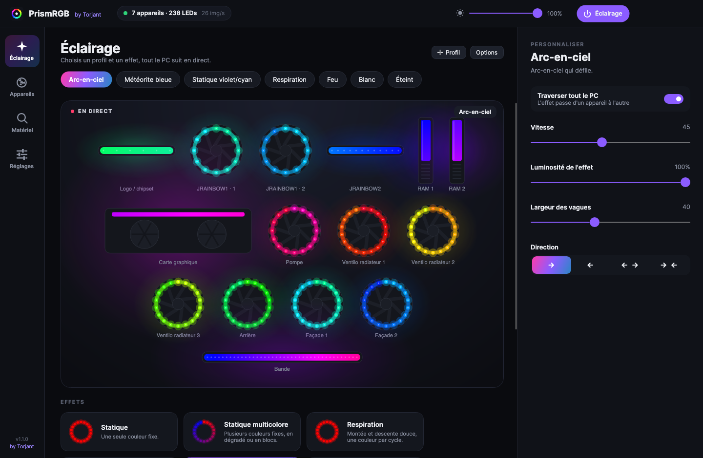
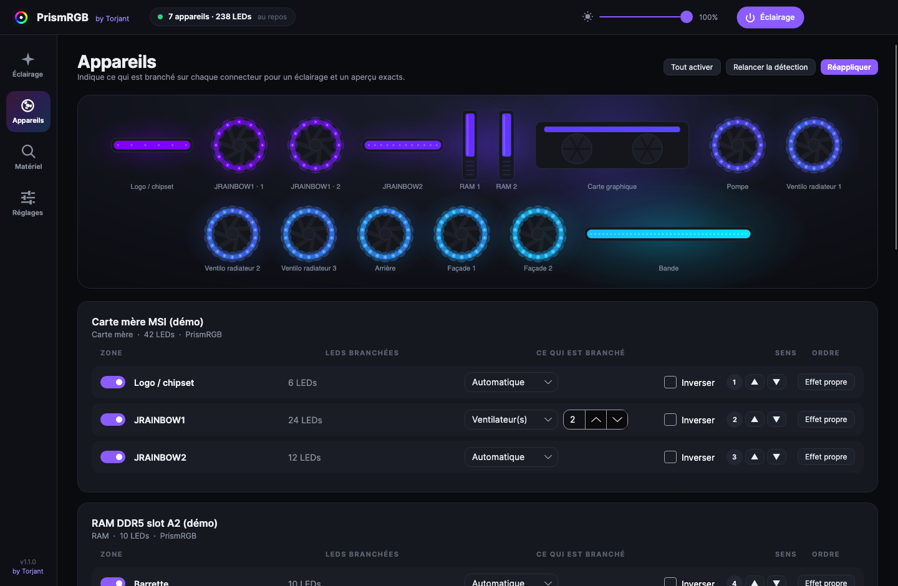
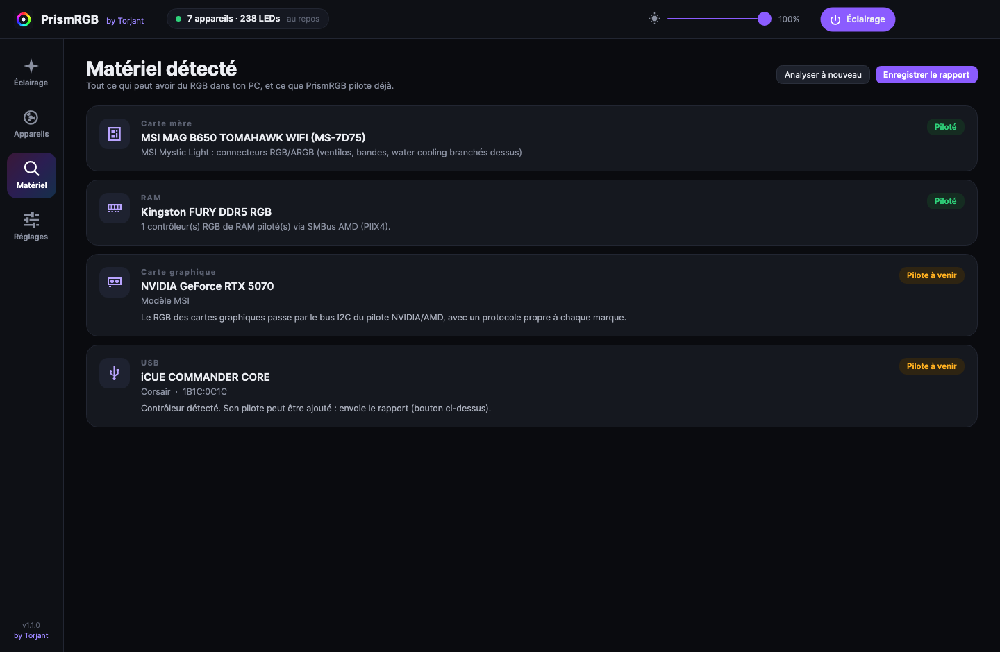

<p align="center">
  
</p>

<h1 align="center">PrismRGB</h1>
<p align="center"><b>by Torjant</b></p>

<p align="center">
  Tout le RGB de ton PC Windows, un seul logiciel, sans rien d'autre à installer.<br>
  <i>All the RGB in your Windows PC, one app, nothing else to install.</i>
</p>

<p align="center">
  <a href="https://github.com/Torjant/PrismRGB/releases/latest"></a>
  <a href="https://github.com/Torjant/PrismRGB/actions/workflows/build.yml"></a>
  
  <a href="LICENSE"></a>
</p>

<p align="center">
  
</p>

<p align="center"><a href="#français">Français</a> · <a href="#english">English</a></p>

---

## Français

### Pourquoi PrismRGB ?

Un PC moderne, c'est du RGB partout : ventilateurs, water cooling, barrettes de RAM, carte graphique, bandes LED du boîtier. Et pour piloter tout ça, il faut d'habitude empiler les logiciels de chaque marque (MSI Center, Armoury Crate, iCUE, RGB Fusion...), lourds, qui se battent entre eux pour le même matériel. Les solutions universelles existantes, elles, « marchent un coup sur deux ».

PrismRGB est né de cette frustration. L'objectif : **un seul logiciel, léger, qui détecte tout seul le matériel et qui fonctionne à chaque fois**, avec de vrais effets synchronisés sur tout le PC.

### Fonctionnalités

- **Détection automatique** de la carte mère, de la RAM, de la carte graphique et des contrôleurs USB RGB au démarrage (et à chaque branchement).
- **Pilotes natifs** : PrismRGB parle directement aux contrôleurs, sans aucun logiciel constructeur.
- **15 effets** : Statique, Statique multicolore, Respiration, Flash, Arc-en-ciel, Cycle spectre, Vague, Météorite, Scanner gauche/droite, Étoiles, Feu, Police, Chenillard, Remplissage, Ondes.
- Couleurs (jusqu'à 8, palettes), vitesse, luminosité, taille, **direction** (gauche, droite, centre vers bords, bords vers centre).
- **Effet qui traverse tout le PC** : les zones sont mises bout à bout dans l'ordre que tu choisis.
- **Effet propre par zone**, zones désactivables ou inversées, ventilateurs chaînés, nombre de LEDs par connecteur.
- **Vitrine en direct** de ton PC et miniatures animées de chaque effet.
- Profils illimités, luminosité générale, bouton marche/arrêt, icône dans la zone de notification, démarrage avec Windows.
- **Zéro impact en jeu** (voir plus bas).

| | |
|---|---|
|  |  |

### Matériel pris en charge

| Matériel | Pilote | État |
|---|---|---|
| Cartes mères **MSI** Mystic Light (B550, B650, X670, B850, X870, Intel 400 à Z890) | USB natif | Testé |
| Cartes mères **ASUS** Aura USB (et contrôleurs Aura ARGB) | USB natif | Expérimental |
| Cartes mères **ASRock** Polychrome USB | USB natif | Expérimental |
| Cartes mères **Gigabyte / AORUS** RGB Fusion 2 (IT8297, IT5702, IT5711) | USB natif | Expérimental |
| Tout ce qui est branché sur ces cartes (ventilos, bandes, water cooling sur JRGB / JARGB / D_LED...) | via la carte mère | Selon la carte |
| RAM **Kingston FURY** Beast / Renegade RGB (DDR4, DDR5) | SMBus via PawnIO | Expérimental |
| RAM à puce **ENE** : G.Skill Trident Z, TeamGroup T-Force, ADATA XPG... | SMBus via PawnIO | Expérimental |
| RAM **Corsair** Vengeance RGB, Dominator Platinum / Titanium | SMBus via PawnIO | Expérimental |
| Cartes graphiques, contrôleurs Corsair / NZXT / Lian Li... | | Détectés, pilotes à venir |

*Expérimental : protocole porté et vérifié octet par octet par les tests automatiques, en attente de retours sur du vrai matériel. Si ça marche chez toi, dis-le dans une issue !*

L'onglet **Matériel** montre exactement ce qui est présent dans ton PC, ce qui est piloté, et produit un rapport à joindre à une issue pour faire ajouter ton matériel.

### Installation

1. Télécharge **`PrismRGB.exe`** dans les [Releases](https://github.com/Torjant/PrismRGB/releases/latest).
2. Double-clique. Rien à installer (Windows 10 ou 11, 64 bits).
3. Ferme les autres logiciels RGB (MSI Center, Armoury Crate, iCUE, SignalRGB...) : deux logiciels sur le même contrôleur = couleurs qui sautent. PrismRGB les signale dans **Réglages**.

> Windows peut afficher « Windows a protégé votre ordinateur » (exécutable non signé par un certificat payant) : **Informations complémentaires** puis **Exécuter quand même**. L'empreinte SHA-256 et l'attestation de provenance de chaque version permettent de vérifier que l'exe vient bien de ce code.

**Premiers réglages :** onglet **Appareils**, indique pour chaque connecteur ARGB le nombre de LEDs branchées et ce qui est branché (bande ou ventilateurs), puis choisis un effet dans **Éclairage**.

### RGB de la RAM

Le RGB des barrettes passe par le bus SMBus de la carte mère, qui n'est accessible qu'avec un pilote système. PrismRGB n'embarque **aucun** pilote noyau : il utilise [PawnIO](https://pawnio.eu/), un pilote gratuit, open source et signé, utilisé aussi par des outils de monitoring reconnus.

1. Installe PawnIO depuis son site officiel (bouton dans **Réglages > RAM**).
2. Active **Contrôle du RGB de la RAM**.
3. Accepte le redémarrage en administrateur. Avec le démarrage automatique, PrismRGB se lance ensuite en administrateur sans fenêtre de confirmation.

Sécurité : PrismRGB identifie les barrettes en lisant leur puce SPD, ne contacte que les contrôleurs RGB de la marque détectée, et **bloque toute écriture dans la mémoire de configuration de la RAM**.

### Performances

- Moins de **0,05 % d'un cœur** de processeur pour animer 240 LEDs à 30 images/s (mesuré).
- **Aucune allocation mémoire** en régime établi : pas de ramasse-miettes qui se réveille en pleine partie (vérifié par les tests).
- Effets fixes : une image est envoyée puis le moteur **dort** jusqu'au prochain changement.
- Fenêtre réduite : plus d'aperçu ni de rendu d'interface, cadence réduite (réglable), **priorité basse** et mémoire rendue à Windows.
- Un thread d'envoi par contrôleur : un contrôleur lent (RAM) ne ralentit jamais le reste.

### Sécurité et vie privée

Aucune connexion réseau, aucune télémétrie, aucune publicité. Code entièrement ouvert, exécutables compilés publiquement par GitHub Actions. Détails dans [SECURITY.md](SECURITY.md).

### Comment il a été créé

PrismRGB est développé par **Torjant** avec l'assistance de l'IA Claude (Anthropic), en C# / .NET 10 et [Avalonia](https://avaloniaui.net/) pour l'interface.

- **Accès matériel natif** : HID Windows (setupapi / hid.dll) pour l'USB, [PawnIO](https://pawnio.eu/) et ses modules officiels pour le SMBus de la RAM.
- **Pilotes** : protocoles portés en C# depuis le formidable travail de rétro-ingénierie de la communauté [OpenRGB](https://gitlab.com/CalcProgrammer1/OpenRGB), puis durcis (détection prudente, protection SPD, reprise automatique après veille ou débranchement).
- **Moteur d'effets** maison, sans allocation, avec plan de rendu mis en cache.
- **Plus de 150 tests automatiques**, dont des cartes mères et barrettes simulées qui vérifient chaque octet envoyé au matériel.

```
src/PrismRGB.Core     moteur, effets, pilotes (Hid, Smbus, Drivers), configuration
src/PrismRGB.App      interface Avalonia
tests/PrismRGB.Tests  tests (faux appareils USB et SMBus)
tools/UiSnapshot      captures de l'interface hors écran
```

### Contribuer

Ton matériel n'est pas reconnu ? **Matériel > Enregistrer le rapport**, puis ouvre une issue « Nouveau matériel » avec le fichier. Voir [CONTRIBUTING.md](CONTRIBUTING.md).

### Compiler depuis les sources

Prérequis : [SDK .NET 10](https://dotnet.microsoft.com/download). `./build-windows.sh` (macOS / Linux) ou `build-windows.ps1` (Windows) lance les tests puis produit `PrismRGB.exe`. Sans matériel : `dotnet run --project src/PrismRGB.App -- --demo`.

### Licence

PrismRGB est un logiciel libre sous **GNU GPL v3.0 ou ultérieure** ([LICENSE](LICENSE)). Concrètement : gratuit, code ouvert, et **toute version modifiée ou redistribuée doit rester libre et publier son code source** sous la même licence. Impossible donc d'en faire un logiciel fermé et payant. Le nom « PrismRGB », la mention « by Torjant » et le logo identifient le projet officiel et ne peuvent pas être utilisés par un fork ni pour vendre un produit ([TRADEMARK.md](TRADEMARK.md)). Composants tiers : [THIRD-PARTY-NOTICES.md](THIRD-PARTY-NOTICES.md).

### Remerciements

La communauté [OpenRGB](https://gitlab.com/CalcProgrammer1/OpenRGB) pour des années de rétro-ingénierie des protocoles RGB, [mystic-why](https://github.com/garashchenko/mystic-why), [SignalRGB](https://signalrgb.com/), [PawnIO](https://pawnio.eu/) (namazso), Mark Kriegsman (FastLED) pour l'algorithme du feu, et l'équipe [Avalonia](https://avaloniaui.net/).

---

## English

### Why PrismRGB?

A modern PC has RGB everywhere: fans, AIO, RAM, graphics card, case strips. Controlling it usually means stacking every vendor's software (MSI Center, Armoury Crate, iCUE, RGB Fusion...), heavy apps that fight each other over the same hardware, while existing universal tools tend to work "every other time".

PrismRGB was born from that frustration. The goal: **one lightweight app that detects your hardware by itself and works every time**, with real effects synchronized across the whole PC.

### Features

- **Automatic detection** of motherboard, RAM, graphics card and USB RGB controllers at startup and on hot-plug.
- **Native drivers**: PrismRGB talks to the controllers directly, no vendor software needed.
- **15 effects**: Static, Multi-color static, Breathing, Flash, Rainbow, Spectrum cycle, Wave, Meteor, Left/right scanner, Stars, Fire, Police, Chase, Wipe, Ripples.
- Colors (up to 8, palettes), speed, brightness, size, **direction** (left, right, center-out, edges-in).
- **Effects that flow across the whole PC**: zones are chained in the order you choose.
- **Per-zone effects**, zones can be disabled or reversed, chained fans, LED count per header.
- **Live view** of your PC and animated thumbnails for every effect.
- Unlimited profiles, master brightness, power toggle, tray icon, start with Windows.
- **No in-game impact** (see below).

### Supported hardware

| Hardware | Driver | Status |
|---|---|---|
| **MSI** Mystic Light motherboards (B550, B650, X670, B850, X870, Intel 400 to Z890) | native USB | Tested |
| **ASUS** Aura USB motherboards (and Aura ARGB controllers) | native USB | Experimental |
| **ASRock** Polychrome USB motherboards | native USB | Experimental |
| **Gigabyte / AORUS** RGB Fusion 2 motherboards (IT8297, IT5702, IT5711) | native USB | Experimental |
| Anything plugged into those boards (fans, strips, AIO on JRGB / JARGB / D_LED...) | via motherboard | Board dependent |
| **Kingston FURY** Beast / Renegade RGB RAM (DDR4, DDR5) | SMBus via PawnIO | Experimental |
| **ENE**-based RAM: G.Skill Trident Z, TeamGroup T-Force, ADATA XPG... | SMBus via PawnIO | Experimental |
| **Corsair** Vengeance RGB, Dominator Platinum / Titanium RAM | SMBus via PawnIO | Experimental |
| Graphics cards, Corsair / NZXT / Lian Li controllers... | | Detected, drivers to come |

*Experimental: protocol ported and verified byte-by-byte by automated tests, awaiting real-hardware feedback. If it works for you, please say so in an issue!*

### Installation

1. Download **`PrismRGB.exe`** from the [Releases](https://github.com/Torjant/PrismRGB/releases/latest).
2. Double-click it. Nothing to install (Windows 10 or 11, 64-bit).
3. Close other RGB software (MSI Center, Armoury Crate, iCUE, SignalRGB...). PrismRGB flags them in **Settings**.

> Windows SmartScreen may warn about an unsigned executable: **More info** then **Run anyway**. Each release ships with a SHA-256 checksum and build provenance attestation.

### RAM RGB

RAM RGB sits on the motherboard SMBus, which requires a system driver. PrismRGB bundles **no** kernel driver: it uses [PawnIO](https://pawnio.eu/), a free, open-source, signed driver. Install PawnIO, enable **RAM RGB control** in Settings and accept the restart as administrator. PrismRGB identifies modules through their SPD chip, only talks to RGB controllers of the detected brand, and **blocks any write to the RAM configuration EEPROM**.

### Performance

Under **0.05% of one CPU core** to animate 240 LEDs at 30 fps (measured), **zero allocations** in steady state (tested), the engine sleeps on static effects, and a minimized window means no UI rendering, lower frame rate, **below-normal priority** and memory handed back to Windows.

### How it was built

PrismRGB is developed by **Torjant** with the help of Claude (Anthropic AI), in C# / .NET 10 with an [Avalonia](https://avaloniaui.net/) UI: native Windows HID access, [PawnIO](https://pawnio.eu/) for the RAM SMBus, drivers ported to C# from the outstanding reverse-engineering work of the [OpenRGB](https://gitlab.com/CalcProgrammer1/OpenRGB) community and hardened, an allocation-free effects engine, and 150+ automated tests with simulated motherboards and RAM checking every byte sent to the hardware.

### Contributing / Building

See [CONTRIBUTING.md](CONTRIBUTING.md). Build with the [.NET 10 SDK](https://dotnet.microsoft.com/download): `./build-windows.sh` or `build-windows.ps1`. Try it without hardware: `dotnet run --project src/PrismRGB.App -- --demo`.

### License

Free software under the **GNU GPL v3.0 or later** ([LICENSE](LICENSE)): free of charge, open source, and **any modified or redistributed version must stay free and publish its source code** under the same license, so it cannot be turned into closed, paid software. The "PrismRGB" name, the "by Torjant" credit and the logo identify the official project and cannot be used by forks or to sell products ([TRADEMARK.md](TRADEMARK.md)). Third-party components: [THIRD-PARTY-NOTICES.md](THIRD-PARTY-NOTICES.md).
